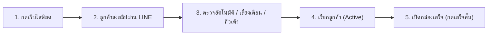

# 📖 คู่มือการใช้งานระบบ AutoQueue for Live
## 【 ฉบับผู้ใช้งาน & แอดมินคุมไลฟ์สด (Operator Edition) 】
> **คู่มือจับมือทำสำหรับมือใหม่: ตั้งแต่เริ่มเปิดโปรแกรม คุมคิวหน้ากล้อง ตรวจสลิปอัตโนมัติ จนถึงสั่งพิมพ์ใบปะหน้า Kerry Express (อ่านเข้าใจง่าย ไม่มีศัพท์เทคนิค)**

---

### 📄 ช่องทางการเปิดอ่าน
* 💻 **ไฟล์ Word (.docx):** วางไว้บนหน้าจอ **Desktop** ของคุณแล้ว 👉 `User_Manual_Operator_Edition.docx` *(เปิดด้วย Microsoft Word เพื่อดูภาพ HD และตารางจัดหน้าสวยงามพร้อมสั่งพิมพ์ได้ทันที)*
* 📂 **ไฟล์ในโปรเจกต์:** [User_Manual_Operator_Edition.docx](file:///c:/Users/napat/OneDrive/Desktop/Project-SlipAPI/User_Manual_Operator_Edition.docx)

---

> [!TIP]
> **🌸 ยินดีต้อนรับสู่ AutoQueue for Live!**
> ระบบนี้สร้างขึ้นเพื่อแม่ค้าและทีมงานไลฟ์สดโดยเฉพาะ ไม่ต้องใช้สมุดจด ไม่ต้องคอยก้มดูยอดเงินในมือถือทีละสลิป ระบบจะเชื่อมต่อกับ LINE Official Account ของร้านเพื่อตรวจสลิปอัตโนมัติ รันคิวขึ้นจอให้ทันที มีระบบทบยอดเมื่อลูกค้าโอนเพิ่ม และสรุปข้อมูลเตรียมพิมพ์ใบปะหน้า Kerry Express ได้ในคลิกเดียวครับ

---

## 🚀 บทที่ 1: การติดตั้งและเริ่มต้นใช้งานครั้งแรก (ภายใน 1 นาที)

สำหรับผู้เริ่มต้นใช้งาน ให้ทำตาม 3 ขั้นตอนง่ายๆ ดังนี้ครับ:
1. **ขั้นตอนที่ 1: ติดตั้งโปรแกรม**
   - ดับเบิลคลิกไฟล์ตัวติดตั้ง **`AutoQueueforLive_Setup.exe`** ที่อยู่บนหน้าจอคอมพิวเตอร์ของคุณ แล้วกด Next ไปจนเสร็จสิ้น (ใช้เวลาไม่ถึง 20 วินาที)
2. **ขั้นตอนที่ 2: เปิดโปรแกรม**
   - เมื่อติดตั้งเสร็จแล้ว ดับเบิลคลิกไอคอนรูปกล่อง **`AutoQueueforLive`** บนหน้าจอ Desktop เพื่อเปิดระบบ โปรแกรมจะเปิดหน้าจอควบคุมขึ้นมาให้อัตโนมัติ
3. **ขั้นตอนที่ 3: เข้าใช้งานครั้งแรก (สำหรับร้านค้า)**
   - หากเป็นการเข้าใช้งานครั้งแรก ระบบจะมีหน้าต่างให้แม่ค้ากำหนดรหัสผ่านของร้าน (เพื่อป้องกันไม่ให้ผู้อื่นเข้ามากดแก้ไขข้อมูลร้านค้า) เมื่อตั้งรหัสผ่านเสร็จแล้วจะเข้าสู่หน้าจอขายของได้ทันที

---

## 🌸 บทที่ 2: การเตรียมพร้อมก่อนเปิดกล้องไลฟ์สด (ใช้เวลาเพียง 2 นาที)

ก่อนเปิดกล้องไลฟ์สด ให้แม่ค้าหรือแอดมินตรวจเช็กและตั้งค่าที่กล่อง **"📦 รายการสินค้าและราคา"** บนหน้าจอหลัก:

1. **กำหนดสินค้าและราคา:**
   - กดปุ่ม `➕ เพิ่มสินค้า` แล้วพิมพ์ชื่อสินค้าในช่องซ้าย และราคาขายในช่องขวา (เช่น `กล่องสุ่ม A` : `189` บาท) สามารถเพิ่มได้หลายรายการตามที่ไลฟ์ขาย
2. **ตั้งค่าส่ง & โปรส่งฟรี:**
   - ใส่ค่าส่งในช่อง `🚚 ค่าส่ง` (เช่น `40` บาท) และใส่จำนวนชิ้นในช่อง `🆓 ส่งฟรีเมื่อ(ชิ้น)` (เช่น `3` ชิ้นส่งฟรี หากไม่มีโปรโมชั่นให้ใส่เลข `0`)
3. **ระบุชื่อบัญชีร้านค้า:**
   - พิมพ์ชื่อบัญชีธนาคารในช่อง `🏦 ชื่อบัญชีร้าน` เพื่อให้ระบบช่วยเช็กว่าสลิปที่ลูกค้าส่งมาโอนเข้าบัญชีร้านเราจริง ป้องกันลูกค้าโอนผิดบัญชีหรือส่งสลิปเก่า
4. **กดบันทึก:**
   - กดปุ่มสีน้ำเงิน `💾 บันทึก` ระบบจะขึ้นข้อความ `✅ บันทึกแล้ว!` เป็นอันพร้อมขายทันที

### การตรวจสอบสถานะระบบและเครดิตตรวจสลิป (แถบด้านบน)
* 🌐 **LINE Webhook (สีเขียว):** แสดงว่าระบบเชื่อมต่อกับ LINE Official Account ของร้านพร้อมแล้ว เมื่อลูกค้าส่งสลิป บอทจะได้รับข้อมูลทันที
* ⚡ **เครดิตตรวจสลิป (สีฟ้า/ส้ม):**
  - **หากใช้ SlipOK:** ระบบจะแสดงยอดจริง เช่น `⚡ SLIPOK: ใช้แล้ว 23/100 (เหลือ 77)` ตามรอบบิล
  - **หากใช้ EasySlip หรือ Thunder:** ระบบจะแสดงเครดิตคงเหลือจริงในกระเป๋า เช่น `⚡ คงเหลือ 150 ครั้ง`
  - **กรณีเครดิตหมด:** ระบบจะสลับไปที่ **"โหมดสำรองตรวจมือฟรี"** ให้อัตโนมัติทันที ออเดอร์ไม่หลุดแน่นอน

---

## 🎮 บทที่ 3: สรุปปุ่มกดและกระดานคิวทั้งหมดในระบบ

### 1. ปุ่มควบคุมหลักด้านบนสุด
| ปุ่ม / สัญลักษณ์ | สี / รูปร่าง | หน้าที่การทำงาน และผลลัพธ์ |
| :--- | :--- | :--- |
| **▶️ เริ่มไลฟ์สด** | สีเขียวสด | กดเมื่อพร้อมเปิดกล้อง ระบบจะเช็กเครดิตให้ล่วงหน้า, เริ่มจับเวลา, และล็อกไม่ให้จอคอมดับตลอดการไลฟ์ |
| **⏱️ 00:00:00** | สีดำ/เขียว | แสดงระยะเวลาที่ไลฟ์สดอยู่จริง ช่วยให้แม่ค้าบริหารเวลาเปิดกล่องและสรุปยอดได้แม่นยำ |
| **⏹️ จบไลฟ์สด** | สีแดง (แสดงเมื่อเริ่มไลฟ์) | กดเมื่อไลฟ์สดเสร็จสิ้น ระบบจะหยุดเวลา และสรุปข้อมูลยอดขายทั้งหมดเข้าสู่ประวัติ |
| **📦 Export Kerry Excel** | สีส้ม Kerry | กดเพื่อดาวน์โหลดไฟล์รายชื่อลูกค้าและที่อยู่ สำหรับนำไปพิมพ์ใบปะหน้า Kerry Express |
| **🔑 ตั้งค่าระบบ (Setup)** | สีเทาขวาบน | กดเพื่อเข้าไปตรวจสอบประวัติการส่งสัญญาณ, เปลี่ยนรหัสผ่านร้านค้า หรือสลับแพ็กเกจ |

### 2. กระดานคิวทั้ง 4 กระดาน และปุ่มบนการ์ดลูกค้า
| กระดานคิว / ปุ่มกด | แถบสีประจำกระดาน | การทำงาน และขั้นตอนที่แม่ค้าต้องปฏิบัติ |
| :--- | :--- | :--- |
| **🎮 คิวที่กำลังเล่น (Active)** | แถบสีน้ำเงิน | แสดงลูกค้าที่แม่ค้ากำลังพูดคุยหรือเล่นกิจกรรมหน้ากล้องขณะนี้ (มีได้ทีละ 1 คิว) |
| ↳ **✅ เสร็จสิ้น** | สีเขียวในการ์ด | กดเมื่อสรุปของหรือเปิดกล่องให้ลูกค้ารายนี้เสร็จแล้ว คิวจะถูกบันทึกสำเร็จและนำออกจากจอ |
| ↳ **⏭️ ข้าม** | สีเหลืองในการ์ด | กดเมื่อลูกค้าไม่อยู่หรือยังไม่ตอบ เพื่อส่งการ์ดไปพักไว้ในกระดาน Skipped ชั่วคราว |
| **📋 คิวที่กำลังรอ (Waiting)** | แถบสีเขียว | แสดงรายชื่อลูกค้าที่โอนเงินสำเร็จแล้ว กำลังต่อแถวรอเล่นกิจกรรม เรียงตามลำดับ #1, #2, #3... |
| ↳ **📢 เรียกคิว** | สีน้ำเงินในการ์ด | กดเพื่อเรียกลูกค้าคนนี้ขึ้นมาเล่นกิจกรรม การ์ดจะย้ายขึ้นไปอยู่กระดาน Active ทันที |
| ↳ **⏭️ ข้าม** | สีเหลืองในการ์ด | กดเพื่อข้ามคิวนี้ไปก่อน |
| ↳ **❌ ยกเลิก** | สีแดงขอบบาง | กดเพื่อยกเลิกออเดอร์ของลูกค้ารายนี้ (ระบบจะหักยอดเงินและสิทธิ์คืนทันที) |
| ↳ **🔍 เช็คสลิปและใส่ยอด** | สีส้มในการ์ด | จะปรากฏเมื่อลูกค้าส่งสลิปไม่มี QR Code กดเพื่อเปิดดูรูปสลิปและพิมพ์ยอดเงิน |
| **⏭️ คิวที่ถูกข้ามไป (Skipped)** | แถบสีแดง | รวบรวมลูกค้าที่ถูกกดข้ามไว้ เพื่อไม่ให้เสียสิทธิ์การเล่น |
| ↳ **📢 เรียกคิวอีกครั้ง** | สีน้ำเงินในการ์ด | เมื่อลูกค้ากลับมาดูไลฟ์ ให้กดปุ่มนี้เพื่อดึงคิวกลับขึ้นมาเล่นกิจกรรมได้ทันที |
| ↳ **❌ ยกเลิกคิว** | สีแดงขอบบาง | กดยกเลิกคิวและคืนยอดออกหากลูกค้าขอสละสิทธิ์ |
| **📝 สลิปผิดปกติ (Abnormal)** | แถบสีส้ม | แสดงสลิปที่ยอดเงินไม่ตรง หรือสลิปที่รอตรวจสอบความถูกต้องหลังจบไลฟ์ |
| ↳ **✅ ถูกต้อง (รวมยอด)** | สีเขียวในการ์ด | กดยืนยันเมื่อแม่ค้าเช็กแอปธนาคารแล้วพบว่าเงินเข้าจริง |
| ↳ **❌ ไม่ถูกต้อง (ปัดตก)** | สีแดงในการ์ด | กดปัดตกเมื่อพบว่าเป็นสลิปปลอมหรือเงินไม่เข้าจริง |

### 3. หน้าต่างตรวจสอบภาพสลิปจริง (กรณีสลิปไม่มี QR Code)
หากลูกค้าใช้ธนาคารที่สลิปไม่มี QR Code หรือเซิร์ฟเวอร์ธนาคารขัดข้อง ระบบจะแสดงการ์ดสีส้มพร้อมปุ่ม `🔍 เช็คสลิปและใส่ยอด`:
1. **ดูยอดเงินจากภาพขยาย:** ระบบจะเปิดรูปสลิปใบจริงขนาดใหญ่ขึ้นมาให้ดูยอดเงินและชื่อผู้รับ
2. **กรอกยอดเงิน:** พิมพ์ตัวเลขยอดเงินที่โอนจริงลงในช่อง *"กรอกยอดเงินที่โอนจริง"* (เช่น `189` หรือ `378`)
3. **กดยืนยันยอด:** กดปุ่มสีเขียว `✅ ยืนยันยอดเงิน` ระบบจะคำนวณจำนวนชิ้นและย้ายคิวเข้ากระดาน Waiting ให้ทันที
4. **กรณีลูกค้าส่งรูปอื่นที่ไม่ใช่สลิป:** ให้กดปุ่มสีแดง `❌ รูปนี้ไม่ใช่สลิป (ปัดตก)` เพื่อตัดทิ้งทันที

---

## ⚡ บทที่ 4: ลำดับขั้นตอนปฏิบัติจริงระหว่างไลฟ์สด (Step-by-Step)

* **สเต็ป 1: กดปุ่ม `▶️ เริ่มไลฟ์สด`**
  - ระบบจะสแกนความพร้อมของเครดิตตรวจสลิป และล็อกหน้าจอคอมไม่ให้ดับตลอดการไลฟ์
* **สเต็ป 2: ลูกค้าโอนเงิน & ส่งสลิปเข้า LINE OA**
  - ระบบตรวจสลิปอัตโนมัติใน 1-3 วินาที มีเสียงกระดิ่งเตือน และการ์ดคิวเด้งเข้ากระดาน Waiting ทันที
* **สเต็ป 3: ลูกค้าโอนเงินเพิ่มระหว่างรอคิว (Smart Merge)**
  - หากลูกค้าคนเดิมโอนเงินเพิ่ม ระบบจะนำยอดและจำนวนกล่องไป **"ทบเข้ากับการ์ดคิวเดิมทันที"** โดยไม่แตกคิวใหม่ และไม่เสียลำดับคิวเดิม
* **สเต็ป 4: เรียกลูกค้าขึ้นมาเล่นกิจกรรม (`📢 เรียกคิว`)**
  - กดเรียกลูกค้าคนแรก การ์ดจะย้ายขึ้นกระดาน Active ทันที
* **สเต็ป 5: เมื่อเล่นกิจกรรมเสร็จสิ้น (`✅ เสร็จสิ้น`)**
  - กดปุ่มเสร็จสิ้น คิวจะถูกบันทึกสำเร็จและนำออกจากหน้าจออย่างเป็นระเบียบ

---

## 📦 บทที่ 5: ขั้นตอนหลังจบไลฟ์สด & สั่งพิมพ์ใบปะหน้า Kerry Express

1. **กดปุ่มสีแดง `⏹️ จบไลฟ์สด`** เพื่อสรุปยอดขายทั้งหมดของรอบไลฟ์
2. **ตรวจสอบกระดานสลิปผิดปกติ (ถ้ามี):** หากเงินเข้าจริงกดยืนยัน หากเงินไม่เข้าจริงกดปัดตก
3. **ดาวน์โหลดไฟล์ Excel สำหรับ Kerry Express:**
   - กดปุ่มสีส้ม `📦 Export Kerry Excel` ที่มุมขวาบน
   - ระบบ Gemini AI จะดึงชื่อ ที่อยู่ เบอร์โทร จากแชท LINE ของลูกค้ามาจัดเรียงให้อัตโนมัติ
   - กดปุ่ม `📥 ดาวน์โหลดไฟล์ Excel (Kerry)`
4. **นำเข้าเว็บ Kerry EasyShip (พิมพ์ใบปะหน้าใน 1 คลิก):**
   - เข้าเว็บ [Kerry Express EasyShip](https://easyship.kerryexpress.com)
   - ไปที่เมนู "สร้างรายการพัสดุ" -> เลือก "สร้างพัสดุหลายรายการ (Bulk Upload / นำเข้าไฟล์ Excel)"
   - เลือกไฟล์ Excel ที่ดาวน์โหลดมาจากระบบของเรา
   - ข้อมูลของลูกค้าทุกคนจะแสดงขึ้นมาทันที สั่งพิมพ์ใบปะหน้าติดกล่องได้ทันที ไม่ต้องพิมพ์ที่อยู่เองแม้แต่คนเดียว!

---

## 💡 บทที่ 6: คำถามที่พบบ่อยสำหรับแม่ค้ามือใหม่ (FAQ)

> **Q1: ถ้าเน็ตสะดุด หรือเผลอปิดโปรแกรม ข้อมูลคิวและยอดเงินจะหายไหม?**  
> 👉 **ไม่หายแน่นอนครับ!** ข้อมูลทั้งหมดถูกบันทึกลงฐานข้อมูลในเครื่องคอมพิวเตอร์ของคุณแบบเรียลไทม์ทันที เมื่อเปิดโปรแกรมขึ้นมาใหม่ ทุกคิวและยอดเงินจะกลับมาอยู่ที่เดิม 100%

> **Q2: หน้าจอคอมพิวเตอร์จะดับหรือเข้า Sleep Mode ระหว่างไลฟ์ไหม?**  
> 👉 **ไม่ดับครับ!** ทันทีที่กดปุ่มเริ่มไลฟ์สด ระบบป้องกัน Windows Sleep Mode จะทำงานอยู่เบื้องหลัง หน้าจอจะสว่างและพร้อมใช้งานตลอดการไลฟ์

> **Q3: ลูกค้าโอนเงินเข้ามาซ้ำกัน คิวจะเด้งซ้ำไหม?**  
> 👉 ระบบมีระบบป้องกันสลิปซ้ำ (Deduplication) หากลูกค้าส่งรูปสลิปใบเดิมซ้ำเข้ามา ระบบจะไม่รับสลิปซ้ำ แต่หากลูกค้าโอนเงินยอดใหม่จริง ระบบจะทบยอดและจำนวนกล่องเข้าการ์ดเดิมให้อัตโนมัติ

> **Q4: ถ้าเครดิตตรวจสลิปหมดกลางคัน ต้องทำอย่างไร?**  
> 👉 **ไม่ต้องกังวลและไม่ต้องหยุดไลฟ์ครับ!** ระบบจะสลับไปที่ "โหมดสำรองตรวจมือฟรี" ให้อัตโนมัติ โดยสลิปจะเด้งขึ้นมาพร้อมปุ่มสีส้มให้แม่ค้าดูยอดและกดยืนยันด้วยตนเองได้ทันที ออเดอร์ไม่สะดุดแน่นอนครับ

> **Q5: สามารถเปลี่ยนขนาดแพ็กเกจ SlipOK ได้ที่ไหน?**  
> 👉 กดที่ปุ่ม `🔑 ตั้งค่าระบบ (Setup)` ที่มุมขวาบน จะมีตัวเลือกแพ็กเกจ SlipOK (100 / 500 / 1500 / 5000 สลิป) ให้เลือกปรับให้ตรงกับบัญชีจริงของคุณได้ตลอดเวลาครับ

---
*จัดทำโดยทีมพัฒนาระบบ AutoQueue for Live*
